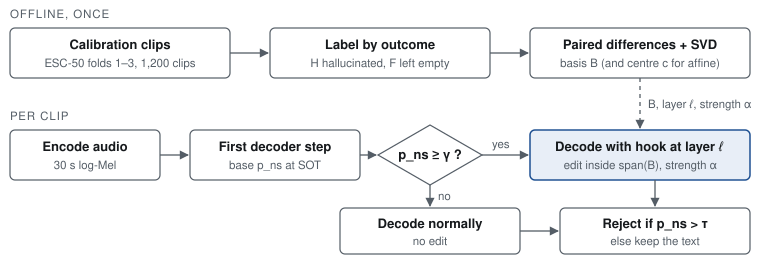
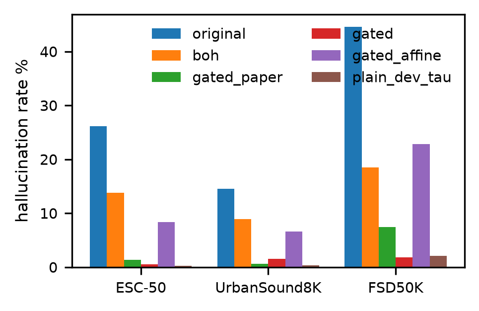
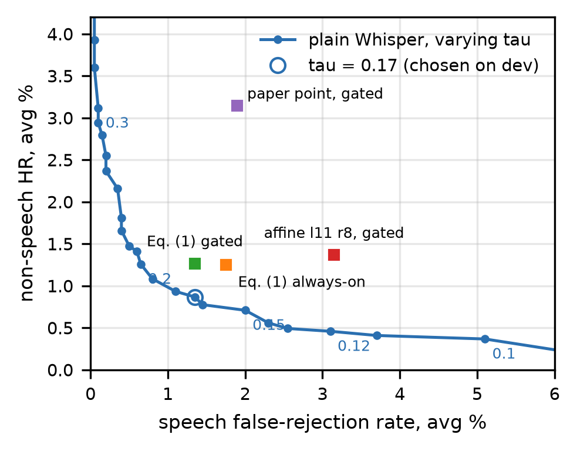
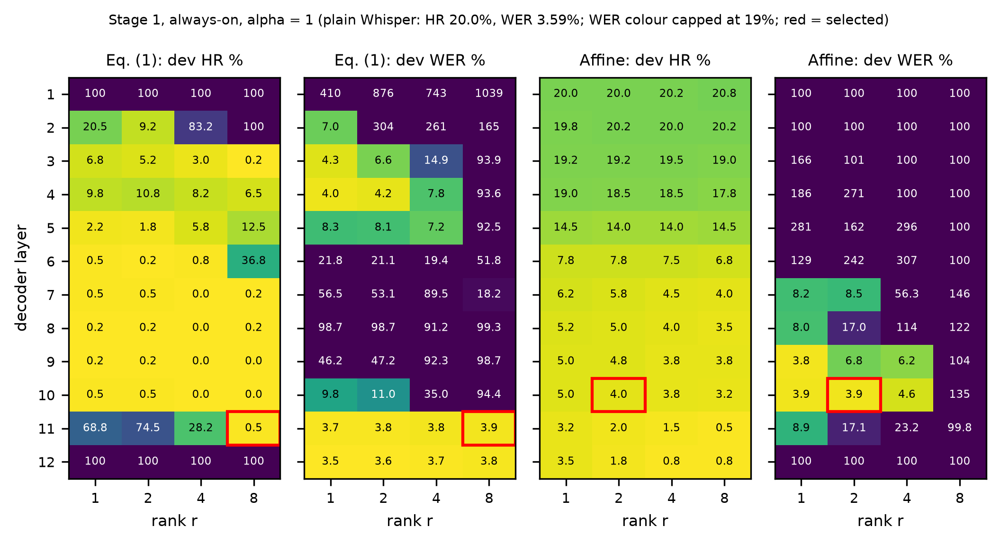
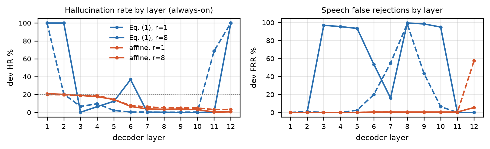

<div align="center">

# Hallucination Space Projection for Whisper

### Reproduction, an Affine Variant, and a Threshold Baseline

**Nongmaithem Hans** (2024AIB1011) · **Ravikant Sharma** (2024AIB1013)

AI553 Speech and Audio Processing · Indian Institute of Technology Ropar<br>
Instructors: Dr. Anusha Prakash and Dr. Arun Kumar Sharma

[](report/Whisper_HalluSpace_Report.pdf)
[](Whisper_Hallucination_Projection.ipynb)
[](https://arxiv.org/abs/2609.04561)

**[Read the full report (PDF)](report/Whisper_HalluSpace_Report.pdf)**

</div>

---

## Overview

Whisper often writes fluent text such as *"thank you"* for audio that has no speech in it: silence, noise, music.
Abbasihafshejani and Jadliwala (arXiv:2609.04561) propose a training-free fix: remove a low-rank
"hallucination subspace" from one decoder layer, but only for clips that Whisper already suspects are non-speech.

In this project we:

- 🔁 **re-implement** the method and reproduce it end to end on Whisper small;
- 📏 add the **baseline the paper leaves out**: plain Whisper with a lower no-speech threshold, chosen by the paper's own rule;
- 🔬 **analyse** what the gate and the edit actually do, and why editing the last layer fails;
- 🧪 test a new **affine variant** that moves states to the empty-class mean instead of to zero.

<p align="center">
  
  <br><sub><b>Gated projection.</b> The basis is estimated once from calibration clips. At test time the edit is applied only when the first-step no-speech probability passes the gate γ.</sub>
</p>

## Key findings

> [!IMPORTANT]
> **The method reproduces, but a tuned threshold does just as well.** Lowering Whisper's rejection threshold from
> 0.6 to 0.17, with no change to the model, gives fewer hallucinations and lower WER than the projection.

| | Result |
|:--|:--|
| ✅ **Reproduction** | At the paper's setting we get a mean hallucination rate of **3.14%**, against the published **3.07%** |
| ✅ **Better tuning** | Our selected setting (layer 11, rank 8) lowers hallucinations from **28.41% → 1.27%** |
| ✅ **Transcripts kept intact** | On utterances the edit lets through, WER is essentially unchanged; the whole cost is rejected speech |
| ⚠️ **Threshold baseline wins** | τ = 0.17 gives **0.87%** HR and **5.93%** WER, against 1.27% and 6.58% for the projection |
| ⚠️ **More speech lost** | At equal hallucination rate the projection rejects significantly more speech (McNemar p = 0.024) |
| ❌ **Affine variant** | Fixes the last-layer failure, but generalises poorly (HR 4.0% on dev, 12.6% held-out) |

## Results

Held-out evaluation on Whisper small. Lower is better everywhere.

| Method | Avg HR % | Avg WER % | Avg FRR % |
|:--|--:|--:|--:|
| Plain Whisper, τ = 0.6 | 28.41 | 5.47 | 0.00 |
| Bag of Hallucinations | 13.70 | 5.47 | 0.00 |
| Gated projection, paper setting (ℓ10 r1) | 3.14 | 6.16 | 1.90 |
| Gated projection, our setting (ℓ11 r8) | 1.27 | 6.58 | 1.35 |
| Gated affine projection (ℓ10 r2) | 12.61 | 5.68 | 0.35 |
| **Plain Whisper, τ = 0.17 (chosen on dev)** | **0.87** | **5.93** | **1.35** |

<sub><b>HR</b>: hallucination rate, averaged over ESC-50, UrbanSound8K and FSD50K (non-speech).
<b>WER</b> / <b>FRR</b>: word error rate and false-rejection rate, averaged over LibriSpeech test-clean and test-other.
Per-dataset numbers, confidence intervals and paired tests are in the report and in <code>results/small/tables/</code>.</sub>

<table>
  <tr>
    <td width="50%"></td>
    <td width="50%"></td>
  </tr>
  <tr>
    <td><sub><b>Hallucination rate per dataset.</b> <code>original</code> = plain Whisper, <code>boh</code> = Bag of Hallucinations,
    <code>gated</code> = our setting, <code>gated_paper</code> = paper setting, <code>gated_affine</code> = affine variant,
    <code>plain_dev_tau</code> = plain Whisper with τ = 0.17.</sub></td>
    <td><sub><b>Trade-off.</b> The line is plain Whisper as the threshold τ varies. No projection setting (squares)
    lies below or to the left of it.</sub></td>
  </tr>
</table>

<p align="center">
  
  <br><sub><b>Layer × rank sweep on development data.</b> Only a narrow region keeps WER close to plain Whisper; red boxes mark the selected settings.</sub>
</p>

<p align="center">
  
  <br><sub><b>Effect of the edited layer.</b> Projecting to zero (blue) fails at layers 1 and 12; the affine variant (orange) behaves smoothly but rejects speech at the last layer.</sub>
</p>

## Repository layout

```text
whisper-halluspace/
├── Whisper_Hallucination_Projection.ipynb   all code: calibration, sweeps, evaluation, analysis, figures
├── requirements.txt                         Python packages
├── report/
│   ├── Whisper_HalluSpace_Report.pdf        the report
│   └── method_overview.svg                  method diagram
├── results/small/                           everything the notebook produced
│   ├── calibration/                         labels and decoder states of the calibration clips
│   ├── sweeps/                              parameter sweeps, dev records, chosen threshold
│   ├── eval/                                one JSONL per method and test set (one line per clip) + summary.json
│   ├── tables/                              result tables (CSV / JSON)
│   ├── figures/                             all figures
│   └── run_info.json                        settings and runtime of the run
└── data/                                    datasets (not included, see below)
```

## How to run

**1. Install**

```bash
pip install -r requirements.txt
```

**2. Download the datasets** into `data/` (about 17 GB in total):

| Folder | Dataset | Source |
|:--|:--|:--|
| `data/ESC-50` | ESC-50 | [github.com/karolpiczak/ESC-50](https://github.com/karolpiczak/ESC-50) |
| `data/UrbanSound8K` | UrbanSound8K | [urbansounddataset.weebly.com](https://urbansounddataset.weebly.com/) |
| `data/FSD50K` | FSD50K (eval audio + ground truth) | [zenodo.org/records/4060432](https://zenodo.org/records/4060432) |
| `data/LibriSpeech` | dev-clean, test-clean, test-other | [openslr.org/12](https://www.openslr.org/12) |

**3. Run the notebook** top to bottom. Finished steps are loaded from `results/small/`, so with the included
results only the analysis is redone; delete `results/small/` to recompute everything. An interrupted cell resumes
from its checkpoint.

<details>
<summary><b>Optional settings</b> (environment variables)</summary>

| Variable | Effect |
|:--|:--|
| `HALLU_MODEL` | Whisper size: `small` (default), `medium`, `large-v3` |
| `HALLU_FULL=1` | Use the full test sets instead of seeded subsets |
| `HALLU_SMOKE=1` | Tiny random model, for a quick pipeline check |
| `HALLU_BS` | Batch size (default 16) |

</details>

**Our run:** Whisper small · NVIDIA RTX 3050 6 GB laptop GPU · fp16 · seed 0 · about three hours in total.

## Contributions

| Member | Contributions |
|:--|:--|
| **Nongmaithem Hans** | Selected the topic and paper; ran all experiments and optimised the pipeline for a 6 GB GPU; designed and carried out the evaluations, comparisons and the affine variant; made the presentation |
| **Ravikant Sharma** | Downloaded and organised the datasets; wrote the initial notebook code; wrote the report from the results |

## Reference

M. Abbasihafshejani and M. Jadliwala, "Reducing hallucinated transcripts in Whisper via hallucination space
projection," arXiv:2609.04561, 2026.
